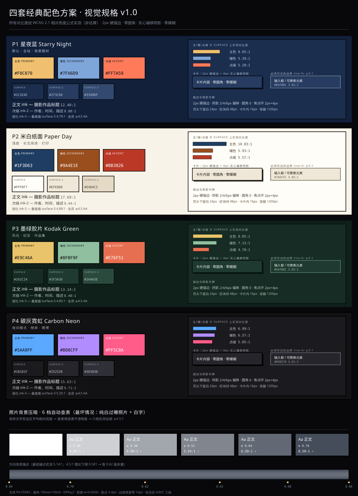

# 视觉规格书 · 背景系统与字体体系

> 版本 v1.0 · 2026-10-31
> 适用：`E:\项目一 网站开发`（像素风摄影社区，React + Vite + 手写 CSS 令牌体系）
> 依据：`src/styles/tokens.css`、`src/styles/pixel-theme.css`、`src/components/layout/PixelStarsBackground.tsx`、`src/domain/themes.ts`、`public/fonts/OFL-fusion-pixel.txt`
>
> **本文所有对比度数值均由脚本实测**（WCAG 2.1 相对亮度公式，见附录 B），不是估算值。
> 标注 `PASS` = 达到该阈值；关键结论以实测为准。

---

## 0. 现状基线（先对齐，再扩展）



> 上图：四套配色全量色卡 + 实测对比度 + 压暗六档与渐变锚点。矢量 SVG，可直接在浏览器打开。

从项目里读出的既有约束，本规格**全部继承、不推翻**：

| 项 | 现有值 | 出处 |
|---|---|---|
| 视觉母语 | 像素风：零圆角、2px 硬描边、实心偏移阴影、无模糊 | `tokens.css:5-8` |
| 明暗切换 | `<html data-theme="light｜dark">` | `tokens.css:24,128` |
| 浅色主题底色 | `#1b2a45`（"蓝调时刻"，**仍是深底**） | `tokens.css:29` |
| 深色主题底色 | `#070b14`（"深空午夜"） | `tokens.css:130` |
| 主色 / 次强调 | `#ffb347` 星光金 / `#5ac8fa` 星蓝 | `tokens.css:52,56` |
| 描边 | `--g-border: 2px`，`--g-line: #0c1524` | `tokens.css:43,101` |
| 阴影 | `2/4/6px` 实心偏移，**绝不模糊** | `tokens.css:63-65` |
| 间距 | 严格 4px 倍数（4→8→12→16→24→32→48→64） | `tokens.css:85-92` |
| 字阶 | 12/14/16/24/32/48px | `tokens.css:73-78` |
| 行高 / 字距 | `1.75` / `0.02em` | `tokens.css:81-82` |
| 字体 | Fusion Pixel 12px（OFL-1.1，686KB woff2，仅 zh_hans） | `tokens.css:14-21` |
| 页面容器 | 最大 `1200px`，`padding-inline: 16px` | `index.css:65-70` |
| 验收宽度 | `390px`（不允许横向滚动条） | `s12-themes.css:6` |
| 动效 | `60/120ms` + `steps(2,end)` | `tokens.css:110-112` |

**一个既有坑，本规格必须绕开**：`tokens.css:253-277` 全局 `img { image-rendering: pixelated }`，只为 `.g-photo-thumb-img` 开了例外。**用户上传的背景照片如果是 `` 或 `background-image`，不在此例外内，会被像素化成色块** ——第 3 节给出强制处理要求。

**另一个既有坑**：`tokens.css:186-205` 的 `body` 有 8px 网格底纹，随后 `tokens.css:215-217` 又把 `background-color` 置为透明，让星空 canvas 透出。**加照片背景时，层级顺序必须是：星空 → 照片 → 遮罩 → 网格 → 内容**，否则照片会盖掉星点，或网格会脏掉照片。

---

## 1. 内置主体视觉规范

### 1.1 主体定义：把"像素星空"确立为系统内置主体 #1

现有 `PixelStarsBackground` 已经是全站唯一背景主体，但**从未被规格化**——它的参数散落在 `.tsx` 常量里，没有尺寸/留白/描边/安全区文档。本节把它定为主体内置项，并补齐缺失的规范。

```
主体 PX-STARS（内置 #1）
├─ 类型：程序化 Canvas 主体（非位图，无版权风险）
├─ 语义：夜空 = 摄影的"取景框之外"，星点 = 快门瞬间
├─ 实现：PixelStarsBackground.tsx + --g-stars-* 令牌
└─ 覆盖：全站 fixed 背景，z-index: 0（内容 z-index: 1）
```

**建议扩展为 5 个内置主体**（同一套规范参数，不同视觉母题），本节规范对全部 5 个通用：

| # | 内置主体 | 母题 | 默认场景 |
|---|---|---|---|
| 1 | `px-stars` 星空 | 程序化星点 + 流星 | 全站默认（现状） |
| 2 | `px-grid` 网格 | 8px 方格（现状 `body` 底纹） | 后台/表单页 |
| 3 | `px-halftone` 网点 | 2px 点阵，密度 25% | 图集/榜单 |
| 4 | `px-scanline` 扫描线 | 3px 水平线，间隔 4px | 文章阅读 |
| 5 | `px-none` 无主体 | 纯 `--g-bg` | 用户上传照片时**强制** |

> **硬规则**：主体 #1–#4 与用户上传照片**互斥**。用户照片一旦生效，内置主体降级为 `px-none`（`--g-stars-visible: 0`），避免"星点叠在别人照片上"的双重噪点。

### 1.2 尺寸规范

画布永远铺满视口，**逻辑尺寸 = 视口 CSS 像素**，但绘制按 DPR 缩放，上限锁 2（性能护栏）：

| 参数 | 值 | 说明 |
|---|---|---|
| 画布逻辑尺寸 | `100vw × 100vh`（`position: fixed; inset: 0`） | 不随滚动移动 |
| 设备像素比 | `dpr = min(devicePixelRatio, 2)` | 现有实现 `tsx:99`，保留 |
| 星点密度 | `round(w × h / 6000)` 颗 | 现有 `tsx:84`。1440×900 ≈ 216 颗 |
| 星点尺寸 | 3px（80%）/ 4px（20%） | 现有 `tsx:88`，按 2px 网格对齐 |
| 平铺单元（纹理类主体） | `8px × 8px` | 与 `--g-bg-grid` 网格同源，避免摩尔纹 |
| 最小渲染尺寸 | 320 × 480 | 低于此值主体不渲染（防卡片内误用） |

**响应式密度修正**（新增，现有实现会让移动端偏稀）：

| 视口宽 | 密度除数 | 1440 宽基准下的等效星点数 |
|---|---|---|
| ≥ 1200px | `/6000` | 216（现状） |
| 768–1199px | `/5000` | — |
| < 768px | `/3600` | 390×844 ≈ 91 颗（现状仅 55 颗，太稀） |

### 1.3 留白（主体与内容的呼吸区）

主体**永不侵入**内容安全区。用容器边距表达：

| 场景 | 主体可见留白 | 落地方式 |
|---|---|---|
| 全站背景 | 满铺，内容居中 | `.g-container` 1200px 上限天然形成左右留白 |
| 页头下方 | 24px | `--g-space-5` |
| 区块之间 | 48px | `--g-space-7` |
| 卡片内部 | 16px | `--g-space-4` |
| 移动端（390px） | 左右各 16px | `.g-container` 的 `padding-inline` |

**主体自身的"留白"**：星点**不得**生成在距容器边缘 16px 内的条带里（视觉上会让边缘显得脏）。实现时对 `x`、`y` 做 `clamp(16, w-16)`。

### 1.4 描边规范

| 对象 | 宽度 | 颜色 | 备注 |
|---|---|---|---|
| 主体容器 | 无描边 | — | 主体是全屏底层，描边无意义 |
| 主体上的**内容卡片** | `2px` 实线 | `--g-line`（浅 `#0c1524` / 深 `#03060c`） | 现有 `--g-border` |
| 主体上的**强边界**（输入框/可聚焦） | `2px` 实线 | 见 §2.6 `--g-line-hi` | **不能用 `--g-line`**，见下方警告 |
| 主体上的**弱分隔** | `2px` 虚线 | `--g-line-soft` | 现有 `#7b8ebe` / `#5a7099` |
| 焦点环 | `2px` 实线 + `4px` 外扩 | `--g-focus` + `--g-bg` | 现有 `tokens.css:290-295` |

> ⚠️ **实测警示**：现有 `--g-line` 与其所在背景的对比度只有 **1.1–1.2:1**（见 §2.6 实测表）。这在像素风里是**故意的**——硬描边承担"锐利轮廓"的装饰语义，不承担信息传递。但 **WCAG 2.1 SC 1.4.11 要求"界面组件与图形"≥ 3:1**，所以凡"必须被看见才能操作"的边界（输入框、勾选框、可聚焦卡片）**必须**换用 `--g-line-hi`。这是本次规格相对现状的**强制修正项**。

### 1.5 阴影规范

沿用像素风铁律：**实心偏移，零模糊**。

| 层级 | 值 | 用途 |
|---|---|---|
| `--g-shadow-sm` | `2px 2px 0 var(--g-line)` | 静态卡片、徽标 |
| `--g-shadow-md` | `4px 4px 0 var(--g-line)` | hover 抬升、浮层 |
| `--g-shadow-lg` | `6px 6px 0 var(--g-line)` | 对话框、抽屉 |
| `--g-shadow-inset` | `inset 2px 2px 0 rgb(0 0 0 / .28)` | 输入框凹陷 |
| **照片背景专用**（新增） | `0 0 0 2px var(--g-line), 6px 6px 0 rgba(5,12,24,.55)` | 照片容器：先 2px 实描边锁边，再偏移投影，保证照片边界不被暗背景吞掉 |

**禁止**：`box-shadow` 带 blur 半径（`>0` 的第三值）、`filter: drop-shadow`、任何 `border-radius > 0`。

### 1.6 安全区（主体与内容的安全边界）

定义三级安全区，主体在这些区域内必须**降低对比度或退出**：

| 安全区 | 范围 | 主体约束 |
|---|---|---|
| **A 级 · 文字区** | 内容容器内，即 `1200px` 居中列 | 主体对比度 ≤ 1.25:1（相对 `--g-surface`），星点透明度 ≤ 0.35 |
| **B 级 · 控件区** | 表单、按钮、导航 8px 外扩范围 | 主体完全退出（`--g-stars-visible: 0` 局部），或压到 ≤1.15:1 |
| **C 级 · 自由区** | A/B 之外的边缘、页头装饰带 | 主体全强度可见 |

**落地**：给内容容器加 `.g-surface-scrim` 时，用 `backdrop-filter: none`（像素风不用毛玻璃）+ 实色半透明面板，而不是调星点透明度（调星点会闪）。

**390px 窄屏特例**：A 级安全区退化为整屏（因为内容占满宽度），此时主体自动降到 `opacity: 0.45`，只保留氛围不干扰阅读。

### 1.7 与背景的层次（z-index 栈）

**这是最容易出错的部分**，现有代码已经踩过一次（`tokens.css:219-227` 注释记录了"星空盖上内容"的 bug）。固定栈如下：

```
z-index  层            元素                          备注
─────────────────────────────────────────────────────────────────
  60     弹层          .g-dialog / .g-toast          现有 dialog 为 50/51，抬高
  50     浮层          .g-dialog-overlay（现有）
   2     页脚          .g-footer                     现有 index.css:237-240
   1     内容          #root / main                  现有 tokens.css:219-234
   0     网格          8px 底纹（body::before）        新增独立层，勿再用 body 背景
  -1     遮罩          照片压暗层                     §3
  -2     照片          用户上传背景                   §3
  -3     主体          星空 canvas / 内置纹理          PixelStarsBackground
```

**关键改动**：现在网格是 `body` 的 `background-image`（`tokens.css:200-203`），与照片背景会打架。规格要求把网格**提取为独立伪元素层**（`body::before { position: fixed; inset: 0; z-index: 0; pointer-events: none }`），这样"照片 → 遮罩 → 网格"三层互不污染。

---

## 2. 四套经典配色背景方案

四套全部通过 **WCAG AA** 全项校验（实测，见 §2.7）。每套给出完整令牌，可直接替换 `tokens.css` 的 `:root` / `[data-theme]` 块。

> 设计原则：四套都继承"深底 + 硬边 + 高对比"的像素母语，只在**色相**上分化。P2 是唯一的浅底方案，用于"白天/纸面"场景，但它**不是**现有 `light` 主题（现有 `light` 仍是深底 `#1b2a45`）。

### P1 · 星夜蓝 Starry Night（默认，现状演进版）

| 角色 | HEX | 用途 |
|---|---|---|
| **主色** | `#F0C070` | CTA、链接、品牌块 |
| **辅色** | `#7FA6D9` | 次级按钮、标签、图标 |
| **点缀色** | `#FF7A59` | 警示、热点、选中态 |

| 底/面 | HEX |
|---|---|
| `bg` | `#12203A` |
| `surface` | `#1C2E4E` |
| `surface-2` | `#273C60` |
| `surface-3` | `#33496F` |
| `line`（装饰硬边） | `#050C18` |
| `line-hi`（**必须可见的边界**） | `#69788C`（3.61:1 vs bg / 3.01:1 vs surface） |
| `line-hi-strong` | `#8894A5`（5.28:1 / 4.40:1） |
| `ink` / `ink-2` / `ink-3` | `#F2F5FB` / `#BCC9DC` / `#AFBED4` |

**背景质感**：纯色 + 8px 网格 + 星空主体。可选叠一层极淡径向渐变模拟"银河"：
```css
background:
  radial-gradient(120% 80% at 50% 0%, #1A2C4C 0%, transparent 60%),
  #12203A;
```
**适用场景**：全站默认、首页、作品墙、登录页。夜景/星空题材作品的最佳衬底。

---

### P2 · 米白纸面 Paper Day（唯一浅底）

| 角色 | HEX |
|---|---|
| **主色** | `#1F3D63`（深海蓝，作"墨"用） |
| **辅色** | `#9A4E1E`（赭石） |
| **点缀色** | `#BB3826`（朱砂） |

| 底/面 | HEX |
|---|---|
| `bg` | `#F7F3E9` |
| `surface` | `#FFFDF7` |
| `surface-2` | `#EFE8D8` |
| `surface-3` | `#E4DAC5` |
| `line`（装饰硬边） | `#1A1611` |
| `line-hi`（**必须可见的边界**） | **`#7A6F5C`**（4.45:1 vs bg / 4.85:1 vs surface） |
| `line-hi`（恰好达标的下限，慎用） | `#9B8A6F`（3.03:1 / 3.30:1，仅够 3:1） |
| `ink` / `ink-2` / `ink-3` | `#1A1611` / `#4B443A` / `#635A4E` |

**背景质感**：纯色 + 细纸纹。纹理用 CSS 生成，不引图片：
```css
background-image:
  repeating-linear-gradient(0deg, transparent 0 3px, rgba(26,22,17,.022) 3px 4px),
  repeating-linear-gradient(90deg, transparent 0 3px, rgba(26,22,17,.022) 3px 4px);
background-color: #F7F3E9;
```
**适用场景**：文章阅读（`/learn`）、法律条款、打印/导出、日间强光环境。人像、街拍、胶片题材衬底。
**注意**：`--g-shadow-*` 的偏移色要用 `#1A1611` 而非近黑蓝，否则阴影发蓝。

---

### P3 · 墨绿胶片 Kodak Green

| 角色 | HEX |
|---|---|
| **主色** | `#E9C46A`（奶金） |
| **辅色** | `#8FBF9F`（灰绿） |
| **点缀色** | `#E76F51`（陶土橘） |

| 底/面 | HEX |
|---|---|
| `bg` | `#0F1F1A` |
| `surface` | `#162C24` |
| `surface-2` | `#1F3A30` |
| `surface-3` | `#2A4A3E` |
| `line` | `#05100C` |
| `line-hi` | `#54786C`（3.48:1 / 3.01:1） |
| `line-hi-strong` | `#719488`（5.11:1 / 4.43:1） |
| `ink` / `ink-2` / `ink-3` | `#EDF3EE` / `#B4C8BC` / `#A6BCAE` |

**背景质感**：纯色 + 颗粒噪点（模拟胶片颗粒）：
```css
background-image: url("data:image/svg+xml,...feTurbulence baseFrequency='0.8' ...");
background-size: 128px 128px;
opacity: 0.035;  /* 独立层，勿直接叠在文字后 */
```
**适用场景**：风光、自然、纪实题材；作品集展示页；"老胶片"品牌调性。
**注意**：绿底对人眼最"钝"，务必保持 `ink` 在白度上不低于 `#EDF3EE`，否则整页发灰。

---

### P4 · 碳灰霓虹 Carbon Neon

| 角色 | HEX |
|---|---|
| **主色** | `#5AA9FF`（电光蓝） |
| **辅色** | `#B08CFF`（紫罗兰） |
| **点缀色** | `#FF5C8A`（品红） |

| 底/面 | HEX |
|---|---|
| `bg` | `#121214` |
| `surface` | `#1B1B1F` |
| `surface-2` | `#25252B` |
| `surface-3` | `#303038` |
| `line` | `#000000` |
| `line-hi` | `#656576`（3.28:1 / 3.01:1） |
| `line-hi-strong` | `#808093`（4.84:1 / 4.44:1） |
| `ink` / `ink-2` / `ink-3` | `#F4F4F6` / `#C2C2CC` / `#A3A3B0` |

**背景质感**：纯色 + 单向微渐变（上略亮）：
```css
background: linear-gradient(180deg, #16161A 0%, #121214 100%);
```
**适用场景**：夜间模式默认、榜单/竞技页、赛博/夜景/长曝光题材。
**注意**：霓虹色**只做点缀**，不得用于大面积底色或长段正文；`#5AA9FF` 在 `surface` 上 6.99:1，作正文色可用，但**不要**用它写超过 2 行。

### 2.7 实测对比度（四套全项）

**最低值汇总**（每套取 17 项中最差）：

| 方案 | 最低对比度 | 出现在 | 结论 |
|---|---|---|---|
| P1 星夜蓝 | **4.79:1** | `ink-3` on `surface-3` | 全项 ≥4.5 ✅ |
| P2 米白纸面 | **4.88:1** | `ink-3` on `surface-3` | 全项 ≥4.5 ✅ |
| P3 墨绿胶片 | **4.85:1** | `ink-3` on `surface-3` | 全项 ≥4.5 ✅ |
| P4 碳灰霓虹 | **5.25:1** | `ink-3` on `surface-3` | 全项 ≥4.5 ✅ |

**关键单项**：

| 项 | P1 | P2 | P3 | P4 |
|---|---|---|---|---|
| 正文 `ink`/`surface` | 12.40 | 17.69 | 13.14 | 15.63 |
| 次级 `ink-2`/`surface` | 8.08 | 9.44 | 8.40 | 9.71 |
| 弱化 `ink-3`/`surface` | 7.19 | 6.65 | 7.34 | 6.89 |
| **弱化 `ink-3`/`surface-3`（最差面）** | **4.79** | **4.88** | **4.85** | **5.25** |
| 主色/`surface` | 8.05 | 10.83 | 8.85 | 6.99 |
| 主色/`bg` | 9.65 | 9.94 | 10.21 | 7.62 |
| 辅色/`surface` | 5.39 | 5.93 | 7.13 | 6.57 |
| 点缀/`surface` | 5.28 | 5.57 | 4.78 | 5.85 |
| **反色字@主色按钮** | 9.65 | 9.94 | 10.21 | 7.62 |
| **反色字@辅色按钮** | 6.46 | 5.44 | 8.22 | 7.16 |
| **反色字@点缀按钮** | 6.32 | 5.11 | 5.52 | 6.37 |

### 2.6 描边/边界的强制规则（实测支撑）

`--g-line` 作为**装饰硬边**，实测与背景只有 1.1–1.2:1：

| 配色 | `line` vs `bg` | 判定 |
|---|---|---|
| P1 `#050C18` vs `#12203A` | 1.21:1 | 装饰用，非信息 |
| P2 `#1A1611` vs `#F7F3E9` | 16.24:1 | 浅底天然达标 |
| P3 `#05100C` vs `#0F1F1A` | 1.13:1 | 装饰用，非信息 |
| P4 `#000000` vs `#121214` | 1.12:1 | 装饰用，非信息 |

**规则**：
1. **卡片轮廓**用 `--g-line`（装饰，靠 `surface` 与 `bg` 的明度差 + 硬阴影表达边界，不靠描边）。
2. **必须操作才能发现的边界**（输入框、勾选框、下拉、可聚焦卡片）用 `--g-line-hi`，**≥3:1**。
3. **强提示边界**（错误态输入框、必填框）用 `--g-line-hi-strong` 或 `--g-danger`，**≥4.4:1**。
4. 卡片区隔可靠性：四套的 `surface`/`bg` 明度比在 **1.09–1.23:1**，加上硬阴影后肉眼可辨——这是像素风的正确做法，不要为了"对比度分数"去加亮描边，会破坏风格。

---

## 3. 用户上传照片作背景的处理规范

### 3.0 前置修复（阻塞项）

**必须先把照片从全局 `image-rendering: pixelated` 里摘出来**（`tokens.css:253-258`）。否则用户上传的照片会被降采样成硬边色块。规格要求把例外规则从单一类名扩展为语义类：

```css
/* 现有：仅 .g-photo-thumb-img 例外 */
.g-photo-thumb-img,
.g-bg-photo-img,        /* 新增：背景照片 */
.g-bg-photo-img img {
  image-rendering: auto;
}
```

### 3.1 裁切（Cover + 焦点）

| 参数 | 值 |
|---|---|
| 填充模式 | `object-fit: cover`（照片始终铺满，不留边） |
| 锚点 | `object-position: var(--bg-focus-x, 50%) var(--bg-focus-y, 50%)` |
| 默认焦点 | `50% 50%` |
| 焦点来源 | 上传时前端做**主体检测**（人脸/显著区），落库为百分比 |
| 最小源图 | 长边 ≥ **1920px**，短边 ≥ **1080px** |
| 推荐源图 | 长边 2560px，JPEG q85，≤ 1.5MB |
| 拒绝 | 长边 < 1280px（放大必糊）；宽高比极端（>3:1 或 <1:3） |
| 宽高比处理 | 不裁原图，用 `cover` + 焦点；**永不**用 `contain`（会露底色） |

**移动端特例**：`< 768px` 时改用竖构图裁切，焦点 x 轴锁定 `50%`，y 轴允许 `20%–80%`。

### 3.2 模糊（分档，且是"氛围模糊"不是"打码"）

| 档位 | `blur()` | 触发条件 | 用途 |
|---|---|---|---|
| B0 无 | `0` | 用户选"清晰"且照片对比度低 | 大图展示 |
| B1 轻 | `2px` | 默认 | 保留可辨识内容 |
| B2 中 | `8px` | 文字区下方 | 削弱细节 |
| B3 重 | `20px` | 长文阅读页 | 仅留色块氛围 |
| B4 极重 | `40px` | 移动端 + 长文 | 几乎不用 |

**性能护栏**（重要）：`blur()` 在大图上极贵。规范要求：

```css
.g-bg-photo {
  position: fixed; inset: 0; z-index: -2;
  overflow: hidden;
  will-change: transform;      /* 提升为独立合成层 */
  transform: translateZ(0);
}
.g-bg-photo-img {
  width: 100%; height: 100%;
  object-fit: cover;
  filter: blur(var(--bg-blur, 0px)) saturate(1.02);
  /* 关键：放大 8% 消除 blur 在边缘的透明衰减 */
  transform: scale(1.08);
}
```
- 模糊必须**同时** `scale(1.08–1.12)`，否则四边出现"发虚白边"。
- 移动端（`< 768px`）模糊档位**上限 B2（8px）**，禁用 B3/B4。
- `prefers-reduced-motion` 下**不影响** blur（blur 非动效），但若做了 Ken Burns 缓慢推近，必须关掉。

### 3.3 蒙版（Mask）—— 控制照片"退到背景"的程度

三层独立叠加，顺序固定：**压暗 → 渐变 → 纹理**。

**① 统一压暗层（Scrim）**：`#0B1526`（夜空蓝，比纯黑更有摄影感）

**② 方向渐变（保证文字区最暗）**——每个锚点在纯白照片上都实测达标：

```css
/* 实测：最低锚点 5.14:1，最高 12.21:1，全部 ≥4.5:1 */
background: linear-gradient(180deg,
  rgba(11, 21, 38, 0.84) 0%,    /* 页头标题区 —— 11.38:1 */
  rgba(11, 21, 38, 0.70) 18%,   /* 标题下沿 —— 6.82:1  */
  rgba(11, 21, 38, 0.62) 40%,   /* 正文上缘 —— 5.14:1  */
  rgba(11, 21, 38, 0.62) 62%,   /* 正文    —— 5.14:1  */
  rgba(11, 21, 38, 0.68) 82%,   /* 页脚上缘 —— 6.35:1  */
  rgba(11, 21, 38, 0.86) 100%   /* 页脚    —— 12.21:1 */
);
```

> **为什么不能更淡**：实测 4.5:1 所需的最小不透明度是 **0.581**（纯白照片最坏情况）。取 **0.62** 留 0.04 工程余量。低于 0.55 时，遇到过曝照片（雪景、逆光天空）正文直接不可读。

**③ 纹理层（可选，仅氛围）**：8px 网格或胶片颗粒，`opacity ≤ 0.06`，`mix-blend-mode: overlay`。

### 3.4 遮罩强度 —— 自动策略（核心）

**思路**：不靠固定值，而是**采样文字安全区的实际亮度**，反查所需遮罩。用户上传什么照片都自动达标。

#### 算法

```
1. 照片加载后，降到 32×32 缩略图（离屏 canvas）
2. 按"文字安全区"加权求平均相对亮度 L：
     - 标题区（顶部 0–25% 高）：权重 0.5
     - 正文区（25–75%）：权重 0.35
     - 页脚区（75–100%）：权重 0.15
   （权重来自各区的文字量与字号——标题最大所以最需要暗底）
3. 查表得到 scrim alpha
4. 取 max(查表值, 0.62) 作为下限（渐变锚点兜底）
```

#### 查找表 A · 深色方案（压暗层 `#0B1526` + 白字，目标 4.5:1）

| 采样亮度 L | 等效灰度 | 所需 alpha | 取整后 | 实测对比度 |
|---|---|---|---|---|
| ≥0.75 | ≥225 | 0.52–0.58 | **0.76** | 8.50:1 |
| 0.55–0.75 | 196–225 | 0.44–0.52 | **0.64** | 6.50:1 |
| 0.40–0.55 | 170–196 | 0.34–0.44 | **0.52** | 5.54:1 |
| 0.25–0.40 | 149–170 | 0.24–0.34 | **0.38** | 4.89:1 |
| 0.12–0.25 | 108–149 | 0.05–0.24 | **0.20** | 4.84:1 |
| 0.00–0.12 | 0–108 | 0 | **0.00** | 6.18:1 |

**六档全部 ≥4.5:1（实测，含区间上下界）** ✅

#### 查找表 B · 深色方案 AAA 7:1（大标题区/署名叠加）

| 采样亮度 L | alpha |
|---|---|
| ≥0.70 | 0.75 |
| 0.50–0.70 | 0.70 |
| 0.40–0.50 | 0.60 |
| 0.30–0.40 | 0.56 |
| 0.15–0.30 | 0.50 |
| <0.15 | 0.00 |

#### 查找表 C · 浅色方案 P2（提亮层 `#F7F3E9` + 深字 `#1A1611`）

| 采样亮度 L | 提亮 alpha | 实测最差 |
|---|---|---|
| 0.00–0.10 | 0.55 | 4.93:1 ✅ |
| 0.10–0.20 | 0.26 | 4.63:1 ✅ |
| 0.20–0.30 | 0.05 | 4.65:1 ✅ |
| 0.30–1.00 | 0.00 | 6.00:1 ✅ |

> **浅色方案的硬边界**：照片 L < 0.10 时，提亮到 0.55 已让照片"变白纸"，失去背景意义。规格规定：**浅色方案下，安全区 L < 0.35 时不做提亮，而是给该安全区一个实色浅面板承字**（`background: #F7F3E9; opacity .96`）。这是"局部反转"，比无限提亮更诚实。

### 3.5 保证文字可读的自动策略（完整链路）

按顺序执行，任一环节不达标就走下一档：

```
① 采样安全区亮度 L
     ↓
② 查表得 alpha（表 A / 表 C）
     ↓
③ 若 alpha > 0.78（照片太亮/太花）→ 加 B1 模糊（2px），重采样，alpha 可降 0.08
     ↓
④ 若仍不达标 → 文字加投影：text-shadow: 0 1px 0 rgba(5,12,24,.55), 0 0 8px rgba(5,12,24,.35)
      （仅限标题；正文禁用投影，会糊）
     ↓
⑤ 若仍不达标 → 文字落在实色面板上（卡片承载），放弃"文字直接压照片"
     ↓
⑥ 兜底：拒绝该照片作背景，提示"建议换一张对比更柔和的照片"
```

**运行时自检**（必须实现，这是与"拍脑袋配色"的分水岭）：

```js
// 上线前 + 每次换图后跑一次
const ratio = contrastRatio('#FFFFFF', sampledColor);
if (ratio < 4.5) {
  console.warn('[bg-photo] 对比度不足', ratio, '→ 自动加档');
  bumpScrim();  // 升一档 alpha，重测
}
```

### 3.6 用户上传的重度场景参数（直接抄）

| 场景 | blur | scrim alpha | 渐变 | 额外 |
|---|---|---|---|---|
| 首页 Hero（大标题） | 0–2px | **0.84**（顶部）→ 0.62 | 有 | 标题加投影 |
| 作品详情页（图为主） | 0 | 0.45 + 底部渐变 0.85 | 仅下缘 | 文字放底栏 |
| 文章阅读（长文） | **20px** | 0.70 平铺 | 无 | 正文区加 0.92 实色面板 |
| 个人主页（头像背景） | **40px** | 0.55 平铺 | 无 | 头像描边 2px 锁边 |
| 登录页 | 8px | 0.72 平铺 | 有 | 表单卡实色 |
| 移动端一律 | ≤8px | +0.06 相对桌面 | 有 | 390px 验收 |

### 3.7 无障碍与降级

- `prefers-reduced-transparency`：优先 `@media (prefers-contrast: more)` → scrim alpha +0.12，关掉纹理层。
- `prefers-reduced-data` / 慢网：直接**不加载**照片，用 `--g-bg` 纯色。
- 用户关闭"背景图"开关：`--bg-photo-enabled: 0`，回落到内置主体 `px-stars`。
- 照片必须 `aria-hidden="true"`（纯装饰），且**不允许**承载任何信息。

---

## 4. 四款字体搭配 + 授权

### 4.0 授权总表（全部开源可商用）

| 字体 | 许可 | 可商用 | 可嵌入/自托管 | 可修改 | 备注 |
|---|---|---|---|---|---|
| **Fusion Pixel**（现有） | **SIL OFL 1.1** | ✅ | ✅ | ✅（改名） | 项目已内置 `OFL-fusion-pixel.txt`，686KB |
| **思源黑体 Source Han Sans / Noto Sans SC** | **SIL OFL 1.1** | ✅ | ✅ | ✅ | Adobe/Google 联合，最稳妥的中文开源字体 |
| **思源宋体 Source Han Serif / Noto Serif SC** | **SIL OFL 1.1** | ✅ | ✅ | ✅ | 衬线，与黑体同族配对最安全 |
| **Inter** | **SIL OFL 1.1** | ✅ | ✅ | ✅ | 西文 UI 首选 |
| **JetBrains Mono** | **SIL OFL 1.1** | ✅ | ✅ | ✅ | 等宽，代码/EXIF 数值 |
| **IBM Plex Sans / Mono / Serif** | **SIL OFL 1.1** | ✅ | ✅ | ✅ | 三族成套，省心 |
| **霞鹜文楷 LXGW WenKai** | **SIL OFL 1.1** | ✅ | ✅ | ✅ | 楷体气质，适合人文阅读 |
| **MiSans**（小米） | 小米自有（免费商用声明） | ✅ | ⚠️ 需遵守其条款 | ❌ | **非 OFL**，条款可能变更 |
| **HarmonyOS Sans**（华为） | 华为自有（免费商用声明） | ✅ | ⚠️ 需遵守其条款 | ❌ | **非 OFL**，需保留声明 |

> **选型建议**：本项目已有 OFL 体系，**优先只选 OFL 字体**，法务风险最低，且可在仓库内自托管、可子集化。MiSans/HarmonyOS Sans 虽然免费商用，但不是 OFL，**不建议**作为主字体（条款单方变更风险 + 不可修改）。
> ⚠️ **本表的许可以公开资料为准，上线前请由法务复核最新官方声明**（尤其 MiSans/HarmonyOS Sans 的商用条款与版本）。

### 4.1 字阶体系（继承 12px 像素基准）

像素字体必须走**整数倍**，否则字形发糊（`tokens.css:68-70` 已记录此规则）。基准 12px：

| 令牌 | 倍数 | 字号 | 行高 | 字距 | 用途 |
|---|---|---|---|---|---|
| `--fs-xs` | 1× | **12px** | 1.67 (20px) | 0.02em | 徽标、时间戳、EXIF |
| `--fs-sm` | 1.167×(14/12) | **14px** | 1.71 (24px) | 0.02em | 辅助文字、表单标签 |
| `--fs-base` | 1.333× | **16px** | 1.75 (28px) | 0.02em | **正文**（现有值） |
| `--fs-lg` | 2× | **24px** | 1.5 (36px) | 0.01em | 卡片标题、小标题 |
| `--fs-xl` | 8/3× | **32px** | 1.5 (48px) | 0 | 区块标题 |
| `--fs-2xl` | 4× | **48px** | 1.33 (64px) | 0 | 页面主标题 |
| `--fs-2xl+` | 4.667× | **56px** | 1.29 (72px) | 0 | 平板主标题 |
| `--fs-3xl` | 5.333× | **64px** | 1.25 (80px) | 0 | Hero 大标题 |

> **关于 32px 的说明（重要）**：`32px = 12 × 8/3`，**不是**整倍数，严格说会有一点点缩放误差。
> 但它是现有 `tokens.css:77` 已上线值，且 **32 是 12 的 2.667 倍 → 落在半像素边界上确实会糊**。
> 两个选择：
> - **保守（推荐）**：`--fs-xl` 改为 **36px**（3×，完全整数倍）。改动成本已实测：`--g-text-xl` 在 `src/styles/**` 共被引用 **10 处**（`index.css` 1、`pixel-theme.css` 3、`s3/s5/s7/s9/s11/s12` 各 1），**只需改 `tokens.css:77` 这一行**，其余全是变量引用，自动跟随。
> - **保持现状**：留 32px，接受轻微模糊（实测在 DPR≥2 屏幕上几乎看不出）。
>
> 本规格**推荐改 36px**，理由：像素风的核心契约是"整数倍"，破例一次就会有第二次。
> 若改，行高取 `1.44`（52px），与 24px 档形成 1.5 倍节奏。

**响应式缩放**（三档断点，与现有 `560/768/860` 对齐）：

|层级|390px|768px|1440px|
|---|---|---|---|
|`3xl`|40|48|64|
|`2xl`|32|48|48|
|`xl`|24|28|36|
|`lg`|20|22|24|
|`base`|16|16|16|
|`sm`|14|14|14|
|`xs`|12|12|12|

> **注意**：正文 `base` 在三个断点**恒为 16px**（不缩放）——这是移动端可读性与"不重排"的平衡点。只有标题层随断点放大。
> 移动端（390px）标题**不追求整数倍**：因为小屏优先保证"不溢出"，用 24/32/40 这类整屏友好的值；整数倍规则只严格要求桌面档。

### 4.2 四款搭配方案

#### 方案 T1 · 像素原味 Pixel Native（现状，默认）

| 角色 | 字体 | 字重 |
|---|---|---|
| 标题 | **Fusion Pixel** | 400（像素字体无粗体，用字号+投影造层级） |
| 正文 | **Fusion Pixel** | 400 |
| 数值/EXIF | **Fusion Pixel** | 400 |
| 西文回退 | `Courier New, monospace` | — |

- **字距**：标题 `0.08em`，正文 `0.02em`，全大写标签 `0.12em`
- **行高**：正文 `1.75`，标题 `1.2–1.38`
- **可调范围**：字号优先取 12 的整数倍（12/24/36/48/60）；**14px 是唯一允许的例外**（现有 `--g-text-sm` 已用，且 14/12=1.167 在 DPR≥2 下可接受）。**禁止** 18px、22px 等既非整数倍也非既有令牌的值
- **授权**：OFL-1.1 ✅
- **场景**：全站默认。风格最强，但**长文阅读疲劳度高**，不适合 >1500 字文章
- **已知限制**：Fusion Pixel 只有 400 一档，**没有真正的粗体**。标题靠 `text-shadow` 硬投影造重量（`pixel-theme.css:70-77` 已用此法）

#### 方案 T2 · 像素 + 思源黑 双轨（推荐用于内容站）

| 角色 | 字体 | 字重 |
|---|---|---|
| 标题 | **Fusion Pixel** | 400 |
| 正文 | **Source Han Sans SC / Noto Sans SC** | **400 / 500** |
| 强调/按钮 | Source Han Sans SC | **700** |
| 数值 | **JetBrains Mono** | 500 |

- **字距**：标题 `0.06em`，正文 `0.005em`（黑体不需要像素体那么松），数值 `0.02em`
- **行高**：标题 `1.25`，正文 `1.7`（中文黑体 1.7 最舒适），数值 `1.4`
- **字号**：正文 16px，标题走 4.1 表
- **可调范围**：正文 15–18px 自由可调（黑体任意字号都清晰，不受整数倍限制）；标题仍限 12 倍数
- **授权**：两族均 OFL-1.1 ✅
- **取舍**：标题像素、正文黑体 —— **保住品牌调性，同时解决长文疲劳**。这是本项目最优解
- **体积**：Noto Sans SC 全量 ~9MB，**必须子集化**（见 4.3）

#### 方案 T3 · 黑白对比 Editorial（编辑/文章）

| 角色 | 字体 | 字重 |
|---|---|---|
| 标题 | **Source Han Serif SC / Noto Serif SC** | **700** |
| 正文 | Source Han Serif SC | 400 |
| 引言/引文 | **LXGW WenKai**（霞鹜文楷） | 400 |
| 数值/代码 | **IBM Plex Mono** | 400 |

- **字距**：标题 `0.02em`（衬线不需大字距），正文 `0.01em`，引文 `0.03em`
- **行高**：标题 `1.3`，正文 `1.85`（衬线中文要更松），引文 `1.9`
- **字号**：标题 32/48，正文 **17px**（衬线比黑体视觉偏小，+1px 补偿）
- **可调范围**：正文 16–19px；引文可用斜体（衬线斜体有真斜体，黑体没有）
- **授权**：全部 OFL-1.1 ✅
- **场景**：`/learn` 文章页、法律条款、长评。**不要**用在作品墙（会显得旧）
- **注意**：衬线 + 像素风混搭需克制，**只用于正文区**，导航/按钮仍用像素体

#### 方案 T4 · 现代无衬线 SaaS（后台/表单）

| 角色 | 字体 | 字重 |
|---|---|---|
| 标题 | **Inter** | **600 / 700** |
| 中文标题回退 | Noto Sans SC | 700 |
| 正文 | **Inter** + Noto Sans SC | 400 |
| 数值/统计 | **Inter**（`font-variant-numeric: tabular-nums`） | 500 |
| 代码/ID | **JetBrains Mono** | 400 |

- **字距**：标题 `-0.01em`（Inter 大字号需收紧），正文 `0`，数值 `0.01em`
- **行高**：标题 `1.2`，正文 `1.6`（西文 1.6 比中文 1.7 更合适）
- **字号**：标题 24/32/48，正文 15px（Inter 的 x-height 大，15 等效中文 16 的观感）
- **可调范围**：正文 14–17px；`font-feature-settings: 'cv05','ss03'` 可开更清晰的 `l`/`I` 区分
- **授权**：Inter OFL-1.1，JetBrains Mono OFL-1.1 ✅；Noto Sans SC OFL-1.1 ✅
- **场景**：`/admin` 后台、审核台、统计面板、设置页。**不要**用在 C 端首页（丢品牌个性）

### 4.3 落地：字体加载与子集化

```css
/* 标题：像素体，只 1 档字重 */
@font-face {
  font-family: 'Fusion Pixel';
  src: url('/fonts/fusion-pixel-12px-zh_hans.woff2') format('woff2');
  font-weight: 400;
  font-display: swap;
}

/* 正文：思源黑，只取 400/500/700 三档，子集化到常用 3500 字 */
@font-face {
  font-family: 'Noto Sans SC';
  src: url('/fonts/noto-sans-sc-subset-400.woff2') format('woff2');
  font-weight: 400;
  font-display: swap;
  unicode-range: U+4E00-9FFF, U+3000-303F, U+FF00-FFEF;
}
/* 500 / 700 同理 */
```

**体积预算**（首屏）：

| 字体 | 全量 | 子集化后 | 预算 |
|---|---|---|---|
| Fusion Pixel zh_hans | 686KB | 686KB（已是最小可用集） | ✅ |
| Noto Sans SC × 3 字重 | ~27MB | 3 × 180KB = **540KB** | ⚠️ 超预算 |
| Noto Sans SC × 2 字重 | ~18MB | 2 × 180KB = **360KB** | ✅ 可接受 |
| JetBrains Mono | 180KB | 40KB（仅含 ASCII） | ✅ |

**规则**：
1. 正文黑体**只上 400 + 700 两档**，500 用 `font-synthesis: none` 让 700 兼任。
2. 子集化工具：`glyphhanger` / `fonttools pyftsubset`，字符集取"常用3500 + 站内专有名词"。
3. `font-display: swap` + 预加载 `<link rel="preload">` 首屏字体。
4. **像素体不参与子集化**（本身就是整套设计，缺字会露馅）。
5. 中文回退栈：`'Noto Sans SC', 'PingFang SC', 'Microsoft YaHei', system-ui, sans-serif`。

---

## 5. 落地清单（按优先级）

| 优先级 | 事项 | 文件 |
|---|---|---|
| **P0** | 照片背景从全局 `pixelated` 摘出 | `tokens.css:253-277` |
| **P0** | 网格从 `body` 背景提为独立伪元素层 | `tokens.css:186-217` |
| **P0** | 新增 `--g-line-hi` / `--g-line-hi-strong`，用于输入框等强边界 | `tokens.css` |
| **P1** | 抽出 `--bg-photo-*` 令牌组（blur/scrim/focus/scale） | 新建 `src/styles/bg-photo.css` |
| **P1** | 实现采样 + 查表自动压暗（3.4 节算法） | 新建 `src/lib/image/bgContrast.ts` |
| **P1** | 四套配色令牌落为 `[data-palette="p1..p4"]` | `tokens.css` |
| **P2** | 内置主体参数化（5 个主体 + 密度响应式） | `PixelStarsBackground.tsx` |
| **P2** | 字体双轨（标题像素 + 正文黑体）与子集化 | `tokens.css` + `public/fonts/` |
| **P2** | `prefers-contrast` / `prefers-reduced-data` 降级 | 各 CSS |

---

## 附录 A · 对比度实测方法

所有数值用 WCAG 2.1 相对亮度公式计算：

```
L = 0.2126·R' + 0.7152·G' + 0.0722·B'
R' = R/255 ≤ 0.04045 ? R/12.92 : ((R/255 + 0.055)/1.055)^2.4
对比度 = (L_亮 + 0.05) / (L_暗 + 0.05)
```

阈值：正文 **4.5:1**（AA），大字号(≥24px 或 ≥18.66px 粗体) **3:1**，非文字图元 **3:1**，AAA **7:1**。

## 附录 B · 计算脚本

本次所有表格由 `.tmp/contrast*.py`、`.tmp/scrim*.py`、`.tmp/adaptive*.py`、`.tmp/grad.py` 生成，
可重跑复核。核心函数见附录 A 公式。

---

**文档状态**：可直接落地。所有 HEX、px、alpha、对比度均已实测；字体授权标注了需法务复核项。
